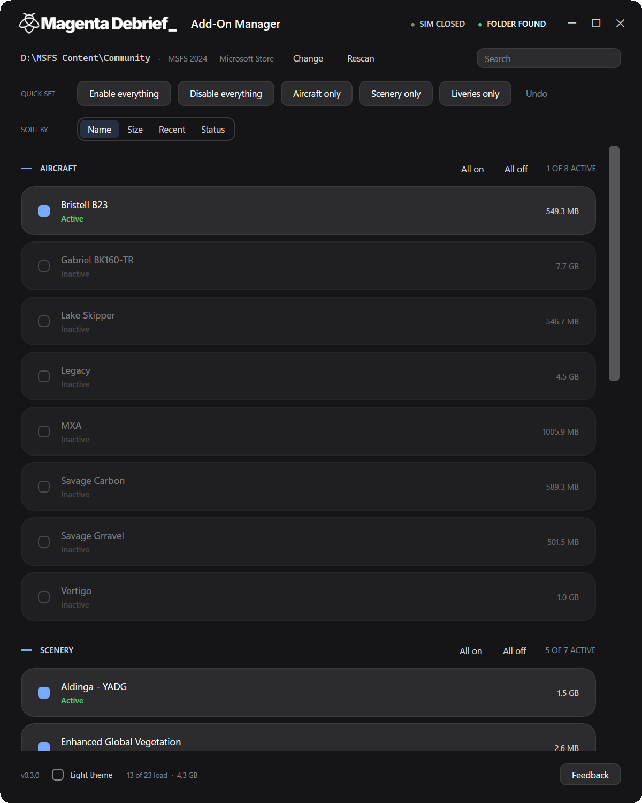
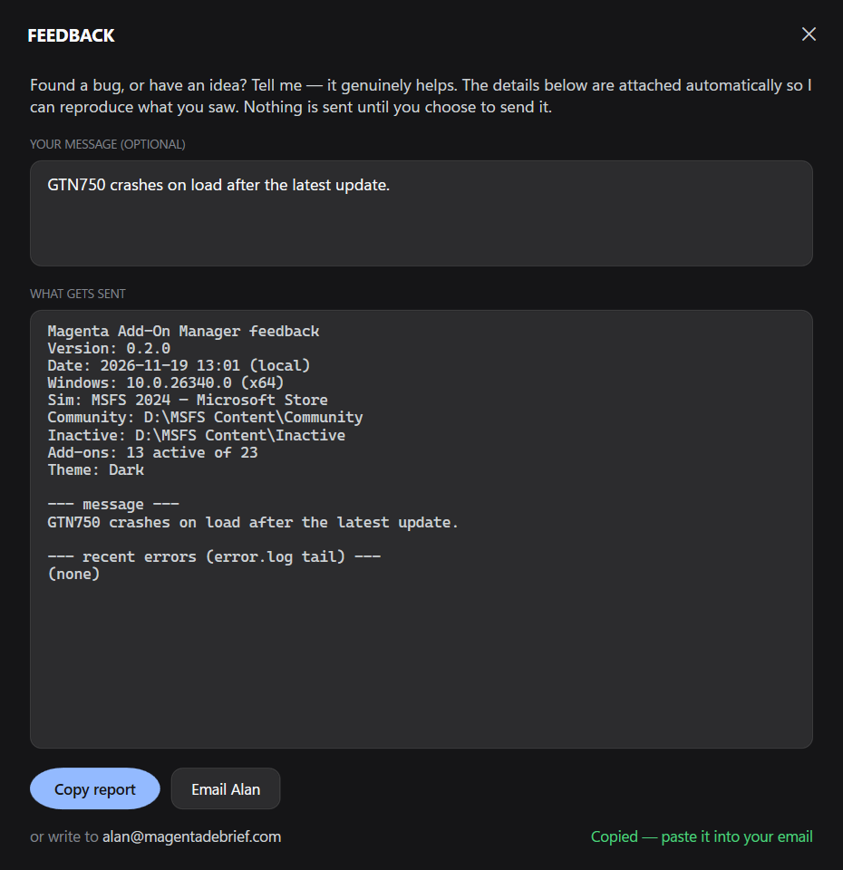

# Magenta Add-On Manager

An elegant Community folder manager for Microsoft Flight Simulator 2024.
One job, done well: see what is in your Community folder, and choose what loads.



## What it does

- **Finds your Community folder automatically** by reading `InstalledPackagesPath`
  from the sim's `UserCfg.opt` — including moved folders on other drives. Covers
  MSFS 2024 (Microsoft Store and Steam) and detects MSFS 2020 installs. If it
  cannot find one, you pick the folder yourself.
- **One click per add-on.** A filled square means the sim loads it; an empty one
  means it does not. The whole row is clickable.
- **Quick sets.** Enable everything, disable everything, or aircraft / scenery /
  liveries only — for testing an update or a new piece of hardware against a
  clean sim, then putting everything back.
- **Undo** that says what it undoes.
- **Search, sort, rescan.** Type to filter; sort by name, size, recent or status
  (loaded first); F5 or Rescan picks up add-ons installed while the app is open
  and tells you what changed.
- **Honest numbers.** Group counts describe the whole folder, the footer shows
  how much actually loads, and add-ons with unusual manifest types are shown
  under *Other* rather than guessed at.
- **One-click feedback.** A Feedback button opens a report with the useful facts
  already attached — version, Windows build, sim edition, paths, counts, and the
  recent error log. You see exactly what will be sent, then copy it or email it.
  No account needed.
- Light and dark themes, remembered between runs.

## What it deliberately does not do

No profiles, no conflict detection, no route finder, no installers, no drag-drop
import. If a feature is not about *what loads right now*, it is not here.

## How it works — your files never move twice

The real content of a managed add-on lives in an `Inactive` folder **next to**
Community (for example `D:\MSFS Content\Inactive`). Community holds only
**NTFS directory junctions** pointing at it:

- **Active** = a junction in Community. The sim reads through it normally.
- **Inactive** = no junction. The sim cannot see the add-on at all, because it
  sits outside Community entirely.

Toggling creates or removes a junction — milliseconds, whether the add-on is
30 MB or 40 GB. Nothing is copied on toggle.

A brand-new add-on you drop into Community is a plain folder, and it just works.
The first time you turn it **off**, it is moved into `Inactive` (instant on the
same drive) and a junction takes its place when you turn it back on. Nothing is
restructured until you ask for it.

### Safety properties

- **Content is never deleted.** Disabling removes a link or parks a folder.
  The app refuses to remove anything that is not a junction it owns.
- **Other tools' links are left alone.** A junction pointing outside this app's
  `Inactive` folder (Addon Linker, a manual link) is refused with an explanation,
  never removed or claimed.
- **No administrator rights, no Developer Mode, no `cmd.exe`.** Junctions are
  written directly as NTFS reparse points. Folder names are data, never command
  text.
- **A scan survives a changing folder.** Locked manifests (an installer
  mid-write), vanished directories and unreadable files are reported, not fatal.
- **Bulk actions report partial failure.** If three of twenty toggles fail, you
  are told which and why.
- While the sim is running, the app says so: changes apply on the next launch.

## Feedback

Found a bug or have an idea? Click **Feedback** in the footer. The app builds a
report with the details that make it reproducible and shows it to you before
anything is sent:



- **Copy report** puts the whole thing on your clipboard.
- **Email Alan** opens a pre-filled message to `alan@magentadebrief.com`.
- **Open GitHub issue** files it on the tracker (once the repo is public).

Nothing is sent automatically and there is no telemetry — you choose what leaves
your machine.

## Requirements

- Windows 10 or 11, x64
- Microsoft Flight Simulator 2024 (Store/Xbox or Steam)
- The release build is self-contained: **no .NET install needed**

MSFS 2020 installs are detected and the mechanism is the same, but 2020 has not
yet been verified on a real install. Reports welcome.

## Install

Download `Magenta Add-On Manager.exe` from the latest release and run it.
There is no installer. To remove it, delete the exe and its Start Menu shortcut;
your add-ons stay exactly where they are.

## Build from source

Requires the [.NET 8 SDK](https://dotnet.microsoft.com/download/dotnet/8.0).

```
git clone https://github.com/flyingsotong/magenta-addon-manager
cd magenta-addon-manager

# run the app
dotnet run --project src/App

# run the proof suite (sandboxed; never touches your real Community folder
# except one read-only check of existing junctions)
dotnet run --project src/Tests -c Release

# publish the self-contained single file
dotnet publish src/App -c Release -r win-x64 --self-contained true ^
  -p:PublishSingleFile=true -p:IncludeNativeLibrariesForSelfExtract=true ^
  -p:EnableCompressionInSingleFile=true -p:DebugType=none -o dist/win-x64
```

## Keyboard

| Key | Action |
|---|---|
| `F5` | Rescan the folder |
| `Ctrl+F` or `/` | Jump to search |
| `Esc` | Clear search |
| `Tab`, then `Space`/`Enter` | Move between add-ons and toggle |

## Where things live

| What | Where |
|---|---|
| Your add-on content | `<Packages>\Inactive` (next to Community) |
| Preferences | `%APPDATA%\Magenta Add-On Manager\settings.json` |
| Error log, if anything ever goes wrong | `%APPDATA%\Magenta Add-On Manager\error.log` |

## License

MIT — see [LICENSE](LICENSE).
